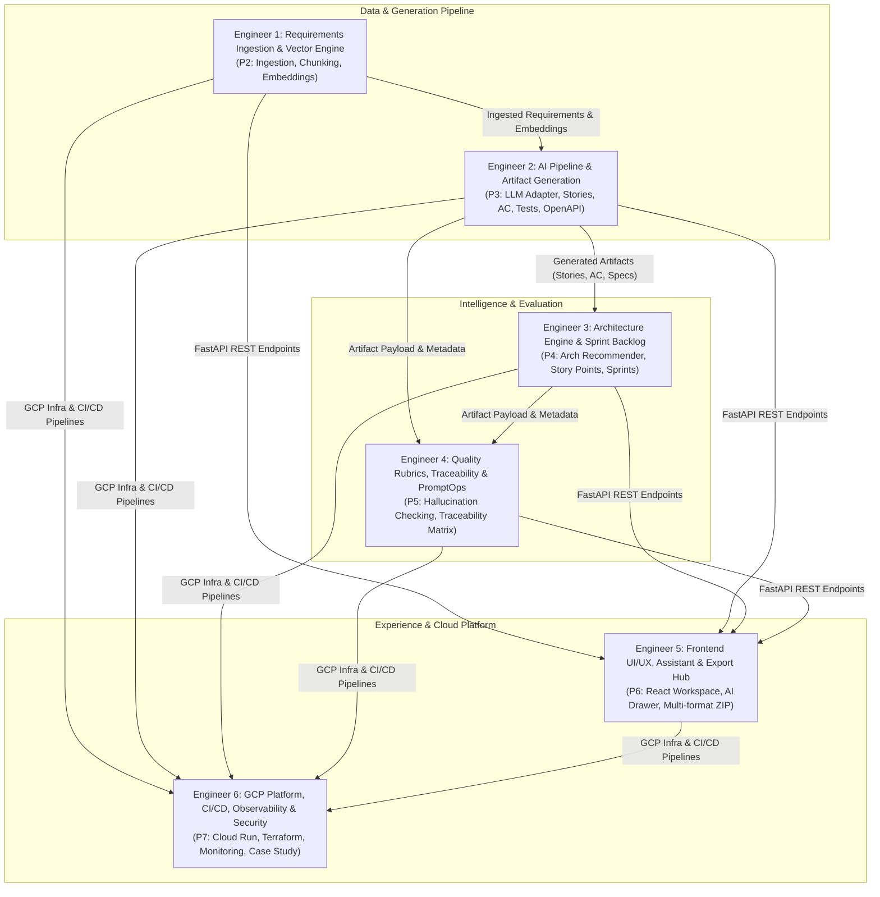

# DevPilot — 6-Person Parallel Work Breakdown Structure (WBS)

**Purpose:** Complete parallelization of the DevPilot platform across 6 engineers with zero blocking dependencies, clear API contracts, and equal workload distribution.



---

## Team Ownership Matrix & Contracts

| Engineer | Focus Domain | Key Deliverables | API Contract / Interface |
|---|---|---|---|
| **Engineer 1** | **Ingestion & Vector DB** | PDF/DOCX/TXT Parser, MoSCoW Tagger, ChromaDB/pgvector | `POST /api/v1/requirements/upload`<br>`GET /api/v1/requirements/search` |
| **Engineer 2** | **AI Pipeline & Artifacts** | LLM Adapter, Story/AC/Gherkin/OpenAPI Generation | `POST /api/v1/projects/{id}/generate`<br>`POST /api/v1/artifacts/{id}/versions` |
| **Engineer 3** | **Architecture & Sprints** | Architecture Recommender, Fibonacci Estimation, Sprints | `POST /api/v1/projects/{id}/architecture`<br>`POST /api/v1/projects/{id}/sprints/plan` |
| **Engineer 4** | **Quality & Traceability** | Automated Rubrics, Hallucination Check, Traceability Matrix | `POST /api/v1/evaluations/score`<br>`GET /api/v1/projects/{id}/traceability` |
| **Engineer 5** | **Frontend UI & Exports** | React UI, Contextual AI Assistant, Multi-format ZIP | `POST /api/v1/projects/{id}/export/zip`<br>`devpilot-frontend/src/features/*` |
| **Engineer 6** | **GCP Infra, CI/CD & Ops** | Cloud Run, GCP Cloud SQL, OpenTelemetry, Benchmarks | `scripts/gcp/*`, `.github/workflows/*`, Runbooks |

---

## Detailed Engineer Assignments

### Engineer 1: Requirements Ingestion & Semantic Vector Engine
- **Primary Modules:** `backend/app/ingestion/`, `backend/app/vector/`
- **Workload:** 16.7%
- **Detailed Tasks:**
  1. Build multi-format document parser supporting PDF (pypdf/pdfplumber), DOCX (python-docx), plain text, and Markdown.
  2. Implement heuristic & LLM requirement extractor splitting text into atomic requirements with unique IDs (`REQ-001`, `REQ-002`).
  3. Create requirement categorization and MoSCoW prioritization tagger (`Must`, `Should`, `Could`, `Won't`).
  4. Setup ChromaDB / pgvector semantic search engine: chunking strategy (500 tokens, 50 token overlap), embedding generation (e.g. `text-embedding-3-small` or local HuggingFace embeddings).
  5. Build REST endpoints:
     - `POST /api/v1/projects/{id}/requirements/upload` (multipart document upload).
     - `GET /api/v1/projects/{id}/requirements` (filterable list by category/priority).
     - `POST /api/v1/projects/{id}/requirements/search` (vector similarity search for RAG).
- **Deliverable:** Fully functional ingestion pipeline passing `test_ingestion.py` and `test_vector_search.py`.

---

### Engineer 2: AI Pipeline & Core Generation Engine
- **Primary Modules:** `backend/app/ai/`, `backend/app/prompts/`, `backend/app/api/artifacts.py`
- **Workload:** 16.7%
- **Detailed Tasks:**
  1. Implement provider-neutral LLM Adapter interface supporting Vertex AI (Gemini 1.5 Pro/Flash), Anthropic (Claude 3.5 Sonnet), and OpenAI with token/cost tracking and exponential backoff retry.
  2. Design, benchmark, and store production prompt templates for:
     - User Stories (As a [role], I want [capability], So that [value] + INVEST validation).
     - Acceptance Criteria (Given-When-Then Gherkin syntax with happy & edge paths).
     - Automated Test Cases (Functional, boundary, security, negative test suites).
     - OpenAPI 3.1 YAML/JSON specifications with strict schema definitions and 4xx/5xx responses.
  3. Implement JSON schema validation on LLM output to guarantee zero hallucinated JSON structures.
  4. Build artifact versioning engine (immutable version history in `artifact_versions`).
  5. Build REST endpoints:
     - `POST /api/v1/projects/{id}/generate/user-stories`
     - `POST /api/v1/projects/{id}/generate/acceptance-criteria`
     - `POST /api/v1/projects/{id}/generate/test-cases`
     - `POST /api/v1/projects/{id}/generate/api-spec`
- **Deliverable:** Robust artifact generation engine passing `test_generation.py` with mock LLM fixtures for CI.

---

### Engineer 3: Software Architecture Recommender & Sprint Planning
- **Primary Modules:** `backend/app/architecture/`, `backend/app/sprints/`
- **Workload:** 16.7%
- **Detailed Tasks:**
  1. Build Software Architecture Recommendation engine:
     - Component topology recommendations (Microservices vs Modular Monolith).
     - Database technology selection logic (Relational, Document, Cache, Vector).
     - Resilience & security patterns (Circuit breaker, rate limiting, JWT + mTLS).
     - Trade-off matrix (latency, scalability, maintenance cost).
  2. Implement User Story Estimation engine:
     - Fibonacci story point estimator (1, 2, 3, 5, 8, 13) based on AC count, technical dependencies, and risk.
  3. Build Sprint Backlog & Dependency Scheduler:
     - Graph-based topological sort to sequence stories based on dependency requirements.
     - Capacity-based sprint packing (e.g. 30 story points per 2-week sprint).
  4. Build REST endpoints:
     - `POST /api/v1/projects/{id}/architecture/recommend`
     - `POST /api/v1/projects/{id}/sprints/plan`
     - `GET /api/v1/projects/{id}/sprints`
- **Deliverable:** Working architecture & sprint planner passing `test_sprint_planning.py`.

---

### Engineer 4: Quality Rubrics, Traceability Matrix & PromptOps
- **Primary Modules:** `backend/app/evaluations/`, `backend/app/traceability/`, `backend/app/promptops/`
- **Workload:** 16.7%
- **Detailed Tasks:**
  1. Build automated Rubric Scoring Engine:
     - Completeness: verifies all source requirements have stories.
     - Groundedness & Hallucination detection: checks generated claims against source PRD embeddings.
     - Consistency: verifies terminology between stories, AC, and OpenAPI specifications.
  2. Implement Traceability Matrix Engine:
     - Bi-directional linking: `PRD Requirement` ↔ `User Story` ↔ `Acceptance Criteria` ↔ `Test Case` ↔ `OpenAPI Endpoint`.
     - Gap analysis: flags orphaned requirements (no stories) or speculative stories (no requirement).
  3. Build PromptOps Library & Versioning:
     - Prompt lifecycle states (`draft` -> `tested` -> `active` -> `retired`).
     - Prompt regression test runner comparing outputs across prompt revisions.
  4. Build REST endpoints:
     - `POST /api/v1/projects/{id}/evaluations/run`
     - `GET /api/v1/projects/{id}/traceability/matrix`
     - `GET /api/v1/prompts` and `POST /api/v1/prompts/{id}/activate`
- **Deliverable:** Traceability & evaluation suite passing `test_evaluations.py`.

---

### Engineer 5: Frontend UI/UX, Contextual Assistant & Export Hub
- **Primary Modules:** `devpilot-frontend/src/features/*`, `devpilot-frontend/src/components/*`
- **Workload:** 16.7%
- **Detailed Tasks:**
  1. Connect frontend views to real backend endpoints using `api.ts`:
     - Requirements Page (upload, tag, review table).
     - Artifacts Hub (tabbed views for Stories, AC, Test Cases, OpenAPI spec viewer).
     - Sprint Planning Board (Kanban drag-and-drop with sprint assignment).
     - Traceability Matrix view with visual link badges.
  2. Implement Contextual AI Assistant Drawer:
     - Global drawer with streaming chat response, active project context awareness, and one-click prompt suggestions.
  3. Interactive Architecture Diagram renderer:
     - Embed live Mermaid.js diagram viewer with zoom/pan and PNG/SVG download.
  4. Export Hub:
     - Multi-format exporter: Markdown documentation bundle, Gherkin `.feature` files, OpenAPI 3.1 YAML/JSON, and formatted ZIP bundle.
- **Deliverable:** Polished, responsive React 19 UI with zero TypeScript errors passing `npm run build`.

---

### Engineer 6: GCP Platform, CI/CD, Observability & Hardening
- **Primary Modules:** `scripts/gcp/`, `.github/workflows/`, `backend/app/core/logging.py`, `docs/*`
- **Workload:** 16.7%
- **Detailed Tasks:**
  1. Maintain and automate GCP Cloud SQL PostgreSQL 16 infrastructure, Cloud SQL Auth Proxy, and database backup routines.
  2. Package and deploy backend to GCP Cloud Run (Serverless container deployment with Cloud SQL VPC Connector and Secret Manager).
  3. Setup GitHub Actions CI/CD Pipeline:
     - Linting (Ruff, ESLint).
     - Unit & integration tests (pytest with in-memory SQLite and PostgreSQL).
     - Docker multi-stage build & vulnerability scanning (Trivy).
  4. Observability & Monitoring:
     - Structured JSON logging with request tracing (`X-Request-ID`).
     - Prometheus metrics endpoint (`/metrics` for request counts, latency, and LLM token expenditures).
     - Health checks (`/health/live`, `/health/ready`).
  5. Open-Source Benchmark Case Study:
     - Validate the Retail Banking case study dataset against the full pipeline.
     - Prepare evidence pack and operational runbook.
- **Deliverable:** Automated CI/CD pipeline, Cloud Run deployment, and comprehensive operational runbook.

---

## Sprint-by-Sprint Parallel Execution Timeline

```
Week 1-2 (Foundation & Ingestion):
  E1: Document Parser & MoSCoW Tagger
  E2: LLM Provider Adapter & User Story Generator
  E3: Architecture Decision Engine Foundation
  E4: Traceability Graph Data Model
  E5: Requirements UI & Artifact Hub Layouts
  E6: Cloud SQL Proxy Setup & CI/CD Pipeline

Week 3-4 (Generation & Intelligence):
  E1: Vector Search (ChromaDB/pgvector) & RAG Embeddings
  E2: Acceptance Criteria & Gherkin Generator
  E3: Story Points Estimator & Sprint Schedulers
  E4: Hallucination & Completeness Rubric Engine
  E5: Contextual Assistant Drawer & Kanban Board
  E6: Cloud Run Staging Deployment & Secret Manager

Week 5-6 (Integration & Evaluation):
  E1: Ingestion Review & Edit Workflow
  E2: OpenAPI 3.1 Spec Generator
  E3: Trade-off Matrix & Sprint Backlog Exporter
  E4: PromptOps Benchmarking & Versioning Engine
  E5: Interactive Mermaid Visualizer & Multi-format ZIP Hub
  E6: Prometheus Metrics, Observability & Load Testing

Week 7-8 (Hardening & Delivery):
  All: End-to-end integration across all 6 modules
  E5 + E6: Retail Banking Case Study Execution & Evidence Pack
  E1-E4: Full Automated Test Suite Coverage (≥80%)
```
