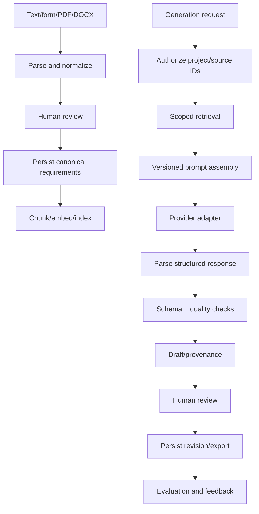

# AI Pipeline and RAG

## Retrieval
Chunk by semantic units and retain document/page/section, requirement ID, project ID, parser/embedding version and content hash. Filter by authorized project and selected source IDs before ranking. Return source IDs and scores; similarity is not calibrated confidence. If context is missing, disclose the gap rather than inventing facts.

## Prompt assembly and provider
Combine trusted task policy, artifact instructions, immutable prompt version, validated options, authorized retrieved context and output schema. Treat source text as untrusted data, not instructions. Provider interface normalizes output, provider/model, usage, latency and errors.

## Validation and review
Parse output, validate versioned schema, run deterministic checks (required fields, traceability, duplicate keys, dependency cycles, OpenAPI/Gherkin validity), record warnings, and reject malformed output. Optional repair is bounded and revalidated. Label all results AI-generated until human approval.

## Reliability/privacy
Retry transient failures with exponential backoff/jitter and bounded attempts. Fallback only to explicitly approved providers. Persist prompt/model/config/retrieval IDs and validation. Only public/synthetic or explicitly permitted academic data; no confidential banking/customer data or proprietary sponsor content sent to LLM APIs.
