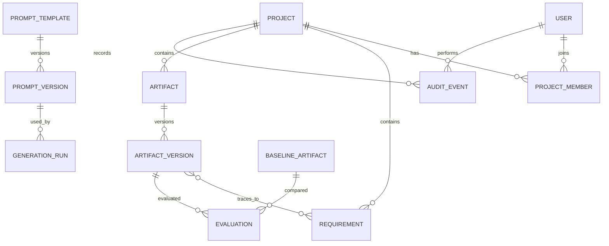

# Data Model

PostgreSQL is canonical; vector entries and aggregates are derived. Use UTC timestamps, foreign keys, project scoping, versioned records and migrations.

## Entities
- `users`: ID, unique normalized email, password hash, active flag, timestamps, failed-login metadata.
- `projects`, `project_members`: project metadata, membership, role.
- `documents`: uploader, safe filename, MIME, size, checksum, storage key, parse status.
- `requirements`: project/document IDs, source and normalized text, category, priority, tags, source location, status/version.
- `artifacts`, `artifact_versions`: type, title, payload/rendered text, schema version, AI flag, review status, creator and version.
- `artifact_requirement_links`, `artifact_dependencies`: explicit traceability/dependency edges.
- `generation_runs`: request ID, source IDs, prompt/provider/model, parameters, status, latency, usage/cost if available, validation.
- `prompt_templates`, `prompt_versions`, `prompt_tests`: metadata, immutable versions, variables/schema, tests and activation history.
- `baseline_artifacts`, `evaluations`: baseline provenance, metric values, method version and reviewer feedback.
- `audit_events`: actor, project, action, resource, timestamp, request ID and safe metadata.
- `sprint_plans`, `sprint_items`; `assistant_sessions`, `assistant_messages`; hashed, expiring `password_reset_tokens`.

## Constraints and indexes
Unique email; unique prompt version per template; unique artifact version per artifact. Index project/time for requirements, artifacts, evaluations, audit events; index foreign keys and generation status. Vector metadata includes project/source IDs, chunk index and content hash. Never trust UI-only project filtering.

## Retention
Define deletion and retention for source files, chat history and audit events before implementation. Do not log secrets. Vector index must be rebuildable from authorized canonical content.
