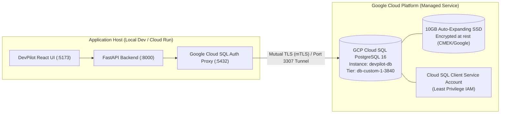

# GCP Cloud SQL Database Migration Guide

**Traceability:** UC-13, Non-Functional Architecture, GCP $300 Free Credits Optimization.

## 1. Overview & Architecture

DevPilot supports migrating from local containerized PostgreSQL (`postgres:16-alpine` in Docker) to a fully managed **Google Cloud SQL for PostgreSQL 16** database hosted on Google Cloud Platform (GCP).

This guide is tailored specifically to maximize the value of the **Google Cloud $300 Free Credits Tier**, ensuring high availability, enterprise security (mTLS, encryption-at-rest, IAM-authenticated connections), and optimal credit burn rate.



---

## 2. $300 Free Credits Budget & Cost Management

To guarantee that the $300 credit covers multiple months of development while leaving ample credits for LLM API experimentation and compute:

| Configuration Item | Recommended Setting | Monthly Est. Cost | Rationale |
|---|---|---|---|
| **Database Engine** | PostgreSQL 16 Enterprise | Included | Native UUID, JSONB, and pgaudit support |
| **Machine Type** | `db-custom-1-3840` (1 vCPU, 3.75GB RAM) | ~$25.00 / month | Optimal balance of performance and async connection pool |
| **Alternative Low-Cost** | `db-f1-micro` (Shared Core) | ~$7.50 / month | Ideal for light staging / zero-cost development |
| **High Availability** | `ZONAL` (Single Zone) | $0.00 extra | Avoids redundant standby compute charges during dev |
| **Disk Type & Size** | PD-SSD 10GB | ~$1.70 / month | Lowest storage tier with auto-resize enabled |
| **Egress / Ingress** | Same-region proxy or internal VPC | Negligible (<$0.50) | In-region traffic is free/low cost |
| **Total Projected Cost** | **~$10 – $27 / month** | **< 10% of $300 credits** | **Lasts 11+ months on $300 credit** |

> [!TIP]
> **Auto-Stop Script for Idle Hours:** Cloud SQL charges only while the instance is running. You can pause the instance overnight to save 60% more credits:
> ```bash
> # Stop instance (stops compute billing)
> gcloud sql instances patch devpilot-db --activation-policy=NEVER
>
> # Resume instance
> gcloud sql instances patch devpilot-db --activation-policy=ALWAYS
> ```

---

## 3. Automated Provisioning

We provide automated setup scripts in both Bash and PowerShell, as well as a Terraform module.

### Method A: Automated PowerShell (Windows)
Run from the repository root:
```powershell
.\scripts\gcp\setup_cloud_sql.ps1 -ProjectId "YOUR_GCP_PROJECT_ID" -Region "us-central1"
```

### Method B: Automated Bash (Cloud Shell / Linux / macOS)
```bash
chmod +x ./scripts/gcp/setup_cloud_sql.sh
export GCP_PROJECT_ID="YOUR_GCP_PROJECT_ID"
./scripts/gcp/setup_cloud_sql.sh
```

### Method C: Terraform Infrastructure as Code
```bash
cd scripts/gcp/terraform
terraform init
terraform apply -var="project_id=YOUR_GCP_PROJECT_ID"
```

The script automatically:
1. Enables the `sqladmin.googleapis.com` API.
2. Creates the PostgreSQL 16 instance (`devpilot-db`).
3. Creates the `devpilot` database and `devpilot` user.
4. Generates an IAM service account (`devpilot-cloudsql-sa`) with `roles/cloudsql.client`.
5. Exports `service_account.json` for proxy authentication.

---

## 4. Connecting DevPilot to GCP Cloud SQL

### Step 1: Run with Docker Compose (GCP Mode)
A dedicated `docker-compose.gcp.yml` is provided. It includes the official Google Cloud SQL Auth Proxy container:

```bash
# 1. Copy GCP environment template
cp .env.gcp.example .env

# 2. Fill in GCP_PROJECT_ID and CLOUD_SQL_PASSWORD in .env

# 3. Start proxy and backend
docker compose -f docker-compose.gcp.yml up --build
```

### Step 2: Run Alembic Migrations against GCP Cloud SQL
Execute the automated migration and seed script:
```bash
python scripts/gcp/migrate_and_seed_gcp.py
```
This runs:
- `0001_foundation`: Core tables (`users`, `projects`, `project_members`, `artifacts`, `artifact_versions`).
- `0002_real_auth_and_audit`: Real authentication tables (`password_reset_tokens`, `audit_logs`, and lockout fields).
- Seeds 5 enterprise personas (`admin`, `project_manager`, `business_analyst`, `developer`, `tester`) with bcrypt hashes.

---

## 5. Security & Governance Verification

- **Mutual TLS (mTLS):** Cloud SQL Proxy automatically encrypts all traffic using ephemeral SSL certificates rotated every hour.
- **Zero Public DB Exposure:** The PostgreSQL database does not require `0.0.0.0/0` public whitelisting; communication travels over Google IAM-authenticated proxy channels.
- **Audit Logging:** The instance is initialized with `cloudsql.enable_pgaudit=on` to satisfy UC-13 enterprise compliance requirements.
