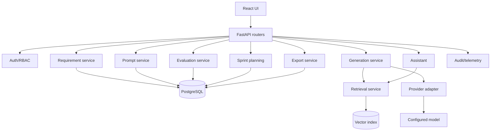

# High-Level Design

## Module responsibilities
Auth/RBAC: identity and resource policy. Requirement: parse and persist requirements. Retrieval: project-scoped chunks and source IDs. Generation: prompt/context/provider/validation orchestration. Prompt library: immutable versions and activation. Evaluation: baseline metrics and reviewer feedback. Planning: capacity/dependency logic. Dashboard: read-only aggregates. Export: serializers and ZIP. Assistant: authorized, grounded Q&A. Audit: security-relevant actions.

## Data flow
Ingest → review/confirm → persist → chunk/embed → retrieve authorized context → assemble versioned prompt → provider call → parse/validate → save draft/provenance → human review → revision/approval → export/evaluation.

## Reliability
Use timeouts, bounded retries, correlation IDs, transactions, safe idempotency for expensive calls, and status records for generation. Do not introduce a queue unless measured latency/availability needs justify it. Logs capture model/prompt version, latency, tokens/cost if available and validation result, never secrets or unnecessary raw content.
