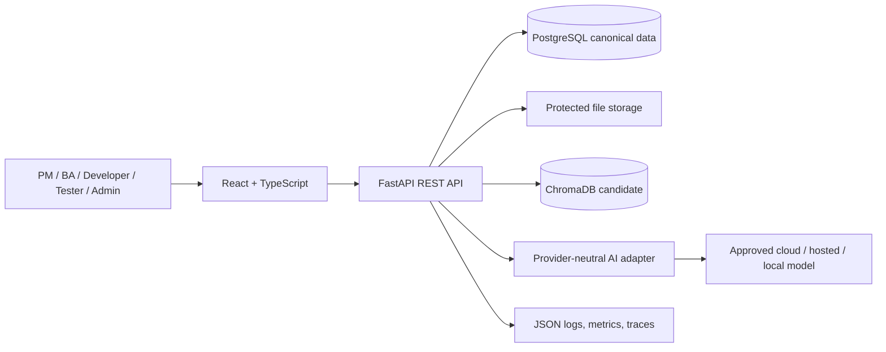

# Solution Architecture

**Status:** Proposed. This is a modular-monolith blueprint, not an implementation claim.

## Principles
API-first; layered separation; SOLID; stable IDs and traceability; model-agnostic adapters; human approval; schema-validated output; canonical relational storage; rebuildable vector index; minimum viable complexity for 12–14 weeks.

## Trust boundaries
Browser→API (untrusted input, TLS, auth, validation, CORS/rate limits); API→stores (least privilege and project scope); API→provider (external data egress); uploaded content→LLM (untrusted instructions); export service→download (safe filenames and ZIP paths).

## Deployment
Docker Compose for UI, API, PostgreSQL and selected vector store. Model provider may be external or local. Do not deploy to production banking infrastructure. Keep state external to API process and configuration outside images.

## Failure behavior
Parser errors are actionable and recoverable. Provider retries are bounded. Invalid structured output is rejected or reported with diagnostics. DB write failure never returns false success. Vector index is derived and rebuildable. Fallback providers require explicit approval and provenance.

## Open decisions
Vector store, file storage, sync vs job-based generation, provider/model, deployment host, email reset adapter, monitoring backend. See [ADRs](ADRS.md).
